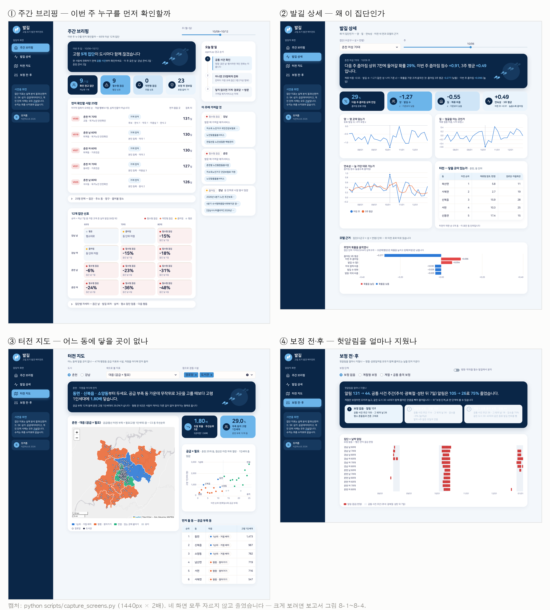

# 발길 — 고립은 발길이 좁아지고 끊기는 일이다

**제14회 빅콘테스트 · AI데이터 활용 분야 · 사회적 고립 예방·대응 AI 에이전트 · 팀 또커톤**

고립은 마음의 상태라 직접 재지 못합니다. 그러나 **고립된 사람은 밖으로 덜 나갑니다.** 가는 곳이 줄고(양), 가더라도 사람을 마주치지 않는 곳으로 가고(질), 늘 가던 리듬이 끊깁니다(연속성). 그래서 **카드 결제와 통신 유동인구로 「발길」을 재고, 발길이 끊긴 집단부터 안부를 묻습니다.**

발길을 재면 **확인해 줄 사람이 같이 나온다**는 것이 이 기획의 전부입니다 — 발길이 어디로 향했는지 알면 그 자리에 있는 사람(단골 가게·경로당)이 누구인지도 알기 때문입니다. 위험도만 내는 지표에는 없는 성질입니다.



---

## 무엇이 달라지나

| | 지금 | 발길 | 재현 |
|---|---|---|---|
| **언제 아나** | 격월 탐색 — 끊긴 뒤 평균 **31.5일** | 주간 루프 — **3.0일** (**28.5일 빠름**) | `scripts/explore_earliness.py` |
| **누구부터 보나** | 경제 지표 상위부터 | 발길이 **좁아질 집단을 한 주 먼저** — 새로 좁아지는 31건 중 **18건** (기준선 0건) | `reanalysis/b3_models.py` |
| **헛알림** | 명절·궂은 날에 무더기로 | 같은 도시 30·40대의 공통 감소를 빼서 **131 → 44건** (명절 주간 105 → 26) | `reanalysis/b2_continuity.py` |
| **어디에 먼저** | — | 공급 부족 동 안에서 고령 1인세대 많은 순 — 무작위 대비 **1.44~1.80배** | `scripts/build_priority.py` |

**한계도 같이 적습니다.** 6개월·두 도시 자료라 계절 한 바퀴를 못 봤고, 새로 좁아진 칸 31건은 소표본입니다. 「기존 체계 보완율」은 동 단위 공개 경제 지표를 구하지 못해 **내지 못했습니다.** 전부 보고서 10절에 있습니다.

## 발길을 네 면으로 잽니다

| 면 | 묻는 것 | 지표 | 단위 |
|---|---|---|---|
| **양** | 몇 곳에 가는가 | 유효 발길 수 `1 ÷ Σp²` (업종 쏠림을 반영) | 집단 |
| **질** | 얼굴을 아는 곳인가 | 체류 비중 — 머무는 업종 11개 ÷ 전 업종 | 집단 |
| **연속성** | 늘 가던 대로 가는가 | 지난 7일 결제가 평소 흔들림의 **3배** 넘게 줄었나 | 집단 |
| **터전** | 닿을 곳이 있는가 | 고령 유동·저녁·일요일·겨울 유지의 도시 안 순위 평균 | 동 |

집단은 **시군구 × 성 × 연령 36칸**, 동은 **행정동 47칸**(강남 22 · 춘천 25)입니다. **카드는 시군구까지만 내려가므로 카드 지표를 동에 붙이지 않습니다.**

## 에이전트가 하는 일

끊김 루프는 주 1회, 좁아짐 루프는 월 1회입니다. **LLM을 부르지 않습니다** — 판단은 규칙과 모델이 하고, 문장은 고정 틀에 계산값을 넣습니다. **에이전트는 제안까지 하고 전화·방문은 사람이 합니다.**

```
네 면 측정 → 상태 판정(끊김·좁아짐·터전 없음) → 명절·날씨 보정
         → 먼저 확인할 사람 3명과 물어볼 창구·장소 → 자원 후보 → 종결 기록
```

확인은 **싼 수단부터**입니다 — ① 본인에게 전화 → ② 발길이 닿던 곳(단골 가게 또는 경로당·마을회관)에 묻기 → ③ 방문. 2단계 상대방은 **그 동의 공급 구성**으로 고릅니다. 가게가 경로당의 3배가 안 되는 동에서는 경로당을 먼저 묻습니다 — 가게가 없는 면 지역일수록 경로당이 많기 때문입니다.

> 개인은 **본인 등록**으로만 연결합니다. 동의 없이 개인을 지목하지 않고, 명부의 개인정보는 집계 바깥으로 나가지 않습니다.

---

## 원본 데이터 없이 되는 것

대회 제공 데이터(신한카드·SK텔레콤)는 재배포할 수 없어 저장소에 없습니다. 대신 **기준 결과와 화면용 집계를 커밋해 두어, 받아서 바로 돌려 볼 수 있습니다.**

```bash
git clone https://github.com/hsoo23/bigcontest-balgil.git && cd bigcontest-balgil
python -m venv .venv && .venv\Scripts\activate          # macOS·Linux: source .venv/bin/activate
pip install -r requirements.txt                          # Python 3.11+ (geopandas 1.2.0)

pip install -r app/requirements-app.txt
streamlit run app/balgil_app.py                          # 담당자 화면 — 위 그림 넷
```

| 원본 없이 | 명령 |
|---|---|
| 담당자 화면 넷 | `streamlit run app/balgil_app.py` (`?screen=1~4`로 한 화면씩) |
| 에이전트 주간 브리핑 | `python scripts/run_agent.py --as-of 2025-10-12` |
| 발표·보고서 그림 16장 | `python scripts/fig_slide_yoonji.py` · `fig_slide_tables.py` · `fig_ground_map.py` · `fig_feedback_loop.py` · `fig_impact_two.py` · `fig_adjust_steps.py` · `fig_stay_heatmap.py` · `fig_screens_grid.py` |
| 보고서·발표자료 묶기 | `python scripts/build_report.py --html` · `build_slides_pptx.py` · `build_pdf.py` |
| 숫자 대조 | `python scripts/check_numbers.py` · `check_terms.py` |

원본이 있어야 도는 것은 정제·모델 파이프라인입니다.

```bash
python scripts/build_processed.py && python scripts/build_external.py   # 정제
python scripts/build_spatial.py && python scripts/build_features.py     # 행정동 연결 · 지표
python reanalysis/a0_load_clean.py
python reanalysis/b1_panel.py && python reanalysis/b2_continuity.py     # 패널 · 연속성(끊김)
python reanalysis/b2b_nomed.py && python reanalysis/b3_models.py        # 병원·약국 분리 · 모델
```

`reanalysis/reference/`에 기준 결과 17개가 들어 있습니다. **셋이 서로 다른 PC에서 네 차례 돌려 맞췄고, 마지막 대조에서 15개가 바이트 단위로 같았습니다**(남은 둘은 파일 모양·반올림 차이). 트리 모델은 기계에 따라 값이 갈려 **기준 환경은 윈도우 AMD64**로 적었습니다 — Apple 실리콘에서는 랜덤포레스트가 16/31로 나옵니다. 그 사실도 보고서 10절에 적었습니다.

## 저장소 둘러보기

| | |
|---|---|
| `src/balgil/` | 정제·지표·**에이전트**(`agent.py` — 도구 18개, 판정과 문장 틀) |
| `reanalysis/` | 지표 패널·연속성·모델 (`a0` → `b1` → `b2` → `b3`) |
| `scripts/` | `build_*` 파이프라인 · `explore_*` 검증 · `fig_*` 그림 · `check_*` 대조 · 제출물 묶기 |
| `app/` | 담당자 화면 (Streamlit) |
| `docs/` | 기획안 · 분석결과 · **[최종 수치표](docs/최종수치표.md)** · 외부 데이터 목록 |
| `docs/draft/` | 보고서 열 절과 발표자료 원고 |
| `reports/` | 묶은 제출물(보고서 · 발표자료) · 그림 · 화면 캡처 |
| `data/reference/` · `reanalysis/reference/` | 원본 없이도 돌도록 커밋해 둔 기준 결과 |

**모든 숫자는 [`docs/최종수치표.md`](docs/최종수치표.md) 한 곳에서 나옵니다.** 보고서·발표자료·화면이 같은 값을 쓰는지는 `python scripts/check_numbers.py`가 셉니다(지금 0개). 쓰지 않기로 한 값과 그 이유도 같은 표에 적어 두었습니다.

## 제출물

| | 만드는 명령 |
|---|---|
| 발표자료 16장 | `python scripts/build_slides_pptx.py` → `reports/발길_발표자료.pptx` |
| 분석보고서 (요약판 · 상세판) | `python scripts/build_report.py --html` → `reports/발길_분석보고서*.md·html` |
| PDF | `python scripts/build_pdf.py` (크롬 헤드리스) |
| 제출 패키지 · 첨부 용량 | `python scripts/build_package.py` |

보고서는 열 절 + 부록 A·B·C(최종 수치표 · 외부 데이터 목록 · 문서 간 불일치 처리)로 묶입니다. 묶을 때 **작업용 표시(담당·기한 머리줄, 「남은 일」 메모, 저장소 링크)를 걷어내고**, 채우지 않은 자리와 없는 그림 파일을 세어 줍니다.

## 데이터

| | 출처 | 기간 |
|---|---|---|
| 제공 데이터 | 신한카드 결제 · SK텔레콤 유동인구 | 2025.7~12 |
| 외부 공공데이터 **10종** | 소상공인 상가정보 · 경로당·마을회관 · 도서관 · 행안부 1인세대·주민등록 인구 · 기상청 ASOS · SGIS 경계 · 복지로 · 1365 봉사 | 출처·수집일·SHA-256은 [`docs/external_data.md`](docs/external_data.md) |

**유료 데이터는 쓰지 않았습니다.** 외부 10종 모두 무료·공개입니다. 100MB를 넘는 원본 두 종은 저장소에 두지 않고 `meta.json`에 받는 법만 적었습니다. 돌봄 명부는 **가상 데이터**이고 파일명과 모든 행에 「가상」을 붙였습니다(생성 방식은 `docs/draft/E5_가상데이터설계자료.md`).

## 만든 사람

**또커톤** — 나수경(지표·에이전트) · 이현수(터전·화면) · 이윤지(모델·통합)

6주 동안 셋이 PR 130여 건으로 작업했습니다. **숫자는 수치표 한 곳에서만 가져오고, 서로의 문서를 교차 검토해 코드와 어긋나는 서술을 찾는 방식**으로 맞췄습니다(`scripts/check_numbers.py`가 그 도구입니다).
