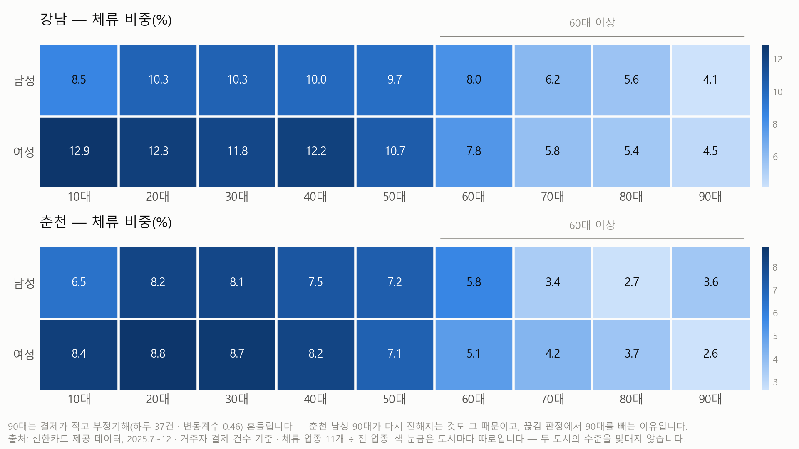

# 4. 분석 근거 — 네 면이 실제로 성립하는가 

**이 절은** 

> 규정의 「데이터 분석 근거 자료」 본체로, 탐색적 데이터 분석, 지역·연령계층별 비교분석 결과, 위험 지표 및 분석 방법 상세 기술에 해당합니다. 지표의 정의는 2절에 있고, 여기서는 그 정의가 데이터에서 성립하는지를 보입니다. 숫자는 모두 최종 수치표(2026-10-17 동결)에서 가져왔습니다.

## 4.1 탐색 — 무엇이 보였나

**질은 나이가 들수록 한 방향으로 떨어집니다.** 체류 비중은 두 도시 · 두 성 모두에서 50대 → 60대 → 70대 → 80대로 줄어듭니다. 같은 성 안에서 80대의 체류 비중은 50대의 0.37\~0.58입니다(춘천 남 0.37 · 여 0.52 · 강남 남 0.58 · 여 0.51, 최종 수치표 5절). 가장 낮은 집단은 춘천 남성 80대입니다.

양은 그렇지 않습니다. 유효 발길 수가 50대에서 80대로 한 방향으로 줄어드는 것은 춘천 여성뿐입니다(80대÷50대 0.774). 강남 남녀는 60대에 떨어졌다가 80대에 다시 올라가고(0.964 · 0.950), 춘천 남성은 60대에 오히려 늘어납니다(9.60 → 11.07, 80대÷50대 1.020). 값은 최종 수치표 6-1 「유효 발길 수 연령별」에 있습니다. 발길이 몇 업종에 퍼져 있는가와 그 업종이 얼굴을 아는 곳인가는 서로 다른 문제이며, 양과 질을 나눠 재는 이유가 여기에 있습니다. 4.4에서 상관으로 다시 확인합니다.

연속성은 고령 집단에서 잴 수 있습니다. 60·70·80대 12집단은 평소 흔들림이 작아 7일 창의 이탈이 드러납니다. 90대는 하루 결제가 37건 수준이고 변동계수가 0.46이어서 평소 수준을 정할 수 없어 뺐습니다(최종 수치표 1절).

터전은 동마다 크게 다릅니다. 60세 이상 천 명당 체류형 점포가 강남은 약 170배(변동계수 0.98), 춘천은 약 44배(0.81) 차이 납니다(최종 수치표 6절). 배수는 가장 적은 동 하나에 크게 좌우되므로 변동계수를 함께 적었습니다.



동별 터전 차이는 6절 그림 6-1에 있습니다.

## 4.2 지역·연령계층별 비교

먼저 무엇을 비교할 수 있는지 정합니다. 카드 표본은 연령대마다 다르게 치우쳐 있습니다. 주민등록 인구와 비교하면 카드는 60대 이상을 거주 인구의 0.51\~0.64배로만 잡고, 30대는 1.53\~1.81배로 많이 잡습니다(최종 수치표 1절 「독립 지표 대조」). 그래서 집단끼리 결제 건수를 직접 비교하지 않습니다. 분모가 그 집단 자신인 **구성비**(체류 비중 · 유효 발길 수)와 같은 집단의 시간 비교(끊김)만 씁니다(최종 수치표 5절 「어떤 양을 비교해도 되는가」).

지역 비교는 도시 안에서만 합니다. 강남 카드는 강남에서 결제한 서울 거주자의 결제여서 출근·쇼핑으로 들어온 소비가 섞여 있습니다. 춘천과 수준을 직접 비교하면 이 목적지 효과를 비교하는 셈이 됩니다. 따라서 「춘천이 강남보다 고립됐다」고 쓰지 않고, 「춘천 안에서 가장 얇은 집단」으로 씁니다.

연령 비교는 같은 성 안에서만 합니다. 성별을 합치면 카드 표본의 성비까지 섞이기 때문입니다. 그래서 체류 비중의 연령 격차는 같은 성 안의 80대÷50대로 나타냅니다(4.1). 기획안의 「춘천 연령 간 2.78배」는 춘천 거주자 결제를 성별 구분 없이 합친 값입니다. 재현은 되지만 이 규칙에 맞지 않아 본문에는 쓰지 않습니다.

1위 집단은 두 기준으로 제시합니다.

| 잣대 | 60대 이상 12칸 순위 (6개월) | 무엇을 말하나 |
|---|---|---|
| 수준 — 체류 비중 원값 | 춘천 남 80대 → 춘천 남 70대 → 춘천 여 80대 → 춘천 여 70대 | 지금 가장 얇은 곳 |
| 나이 보정 — 나이·도시 효과를 덜어 낸 좁아짐 점수 | 강남 여 70대 → 강남 여 60대 → 강남 남 70대 → 춘천 여 60대 | 나이에 비해 이미 좁은 곳(조기 발견) |

두 기준은 서로 다른 집단을 가리킵니다. 수준 상위 넷이 모두 춘천인 것은 앞의 목적지 효과 때문일 수 있어 춘천 안의 순서로만 읽습니다. 나이 보정 점수는 같은 나이 · 같은 도시라면 기대되는 값과의 차이여서 도시를 건너 비교할 수 있습니다. 좁아짐 신호(3절의 노랑)는 나이 보정 점수로 냅니다.

> 주 단위(26주)로 보면 나이 보정의 순서가 조금 다릅니다(강남 여성 60대가 26주 내내 3위 안, 실행계획 2절). 이는 6개월 평균과 주 평균의 차이이며, 강남 여성 60·70대가 맨 위라는 점은 같습니다.

## 4.3 질 지표 검증

질 지표(체류 비중)가 특정 달이나 특정 업종에 기대고 있지 않은지 확인했습니다(`reanalysis/reference/quality_checks.csv`).

| 확인 | 결과 | 뜻 |
|---|---|---|
| **월별 안정성** | **12 / 12** | 60대 이상 12칸 전부 6개월 내내 같은 성 50대보다 낮습니다 |
| **업종 빼기** | **44 / 44** | 체류 업종 11개를 하나씩 빼도 44경우 모두 70대÷50대가 1 아래입니다 |
| **제과점 민감도** | 강남 80대÷70대 0.910 · 0.929 → 1.003 · 1.002 | 제과점을 체류에 넣을 때만 강남에서 80대가 70대와 같아집니다. 식사에 넣으면 그대로입니다 |

결과는 한 달의 우연이나 한 업종의 효과가 아닙니다. 다만 업종 빼기는 한 업종씩 뺀 결과입니다. 가장 크게 흔들리는 것은 커피전문점을 뺄 때입니다(강남은 체류의 대부분이 커피입니다, `분석결과.md` 1.6). 커피를 빼도 70대÷50대는 네 집단 모두 1 아래로 남지만, 80대÷70대는 강남 남성과 춘천 여성에서 1에 닿아 70대와 80대의 순서가 흐려집니다. 44경우 중 80대÷70대가 1 아래가 아닌 것은 이 둘뿐입니다. 따라서 **질 지표는 춘천 남성에서 가장 견고하고, 춘천 여성과 강남 두 집단은 커피 업종에 기대고 있습니다.** 차이는 도시가 아니라 집단 단위로 갈리므로, 지역 교차검증(5절)을 해석할 때도 도시로 묶지 않고 집단별로 봅니다.

> 1차 안에서 80대 반등이 보였던 이유(음식점 혼입)와 이를 체류 · 식사로 나눠 걸러 낸 과정은 2.3에 있습니다. 위 표의 셋째 줄은 제과점이 그 혼입을 되살린다는 결과입니다.

## 4.4 양과 질은 다른 것을 재는가

두 지표가 같은 것을 잰다면 하나는 필요 없습니다. 유효 발길 수와 체류 비중의 상관을 확인했습니다.

| 대상 칸 | 원값 | 그 칸에서 나이 보정 | 36칸 보정 후 부분집합 |
|---|---|---|---|
| 36칸 (90대 포함) | 0.293 | 0.550 | 0.550 |
| 32칸 (모델 패널) | **0.347** | 0.615 | 0.625 |
| 60대 이상 12칸 | 0.261 | −0.119 | 0.172 |

본문 값은 32칸 원값 0.347입니다. 모델 패널과 칸 수가 같고, 보정 없이도 두 지표가 같은 것을 재지 않는다는 결론이 나옵니다. 아홉 값 모두 결론이 같으며, 가장 높은 값(0.625)도 한쪽이 다른 쪽을 대신할만큼 높지 않습니다.

60대 이상 12칸 안에서 다시 보정하면 부호가 바뀝니다(−0.119). 칸이 12개뿐이어서 상관을 신뢰하기 어려우므로 본문에는 쓰지 않습니다. `explore_quality.py`의 0.404는 14셀 기준으로 축이 달라 함께 적기만 합니다(최종 수치표 5절).

4.1의 연령 별 모양도 같은 결과를 보여 줍니다. 질은 나이에 따라 떨어지지만 양은 그렇지 않습니다. 가는 곳의 수가 유지돼도 얼굴을 아는 곳은 줄어들 수 있습니다.

## 4.5 음성 대조 — "당연한 결과"를 먼저 막는다

**질문.** 터전 지표인 60대 이상 유동 비중이 동의 고령 1인세대율을 맞힌다면, 그것은 고립을 잡은 것일까요, 아니면 둘 다 연령 구성을 반영한 것일까요?

**설계.** 같은 방법으로 30·40대 1인세대율을 맞혀 봅니다. 고령에서만 맞고 30·40대에서는 맞지 않으면 연령 구성 때문이 아니라고 볼 수 있습니다. 도시 차이(춘천이 더 고령)를 지우기 위해 도시 안에서 봅니다. 라벨은 행안부 주민등록(2025년 12월)입니다(`scripts/explore_negative_control.py`).

**결과는 예상과 달랐습니다.**

| 도시 안 스피어만 상관 (60대 이상 유동 비중 → 1인세대율) | 강남 (22동) | 춘천 (25동) |
|---|---|---|
| 고령(65세 이상) 1인세대율 | **−0.06** | **0.15** |
| 30·40대 1인세대율 | **−0.61** | **−0.11** |

고령에서도 도시 안에서는 맞지 않습니다(최종 수치표 6-1 「음성 대조 전부」). 두 도시를 섞으면 고령 상관이 0.48로 올라가 맞는 것처럼 보이지만, 이는 도시 차이가 섞인 값으로 기획안이 경고한 연령 구성만 반영한 결과에 해당합니다.

30·40대의 강남 −0.61은 맞지 않은 것이 아니라 반대 방향으로 크게 맞은 것입니다. 30·40대 1인세대가 많은 동일수록 60대 이상 유동 비중이 낮으므로, 이것도 연령 구성 효과입니다. 즉 음성 대조는 통과하지 못했고, **라벨 자체가 성립하지 않는다**는 것을 보여 줬습니다. 고령에서는 맞지 않고, 30·40대에서는 연령 구성 때문에 반대로 맞습니다. 동 단위 1인세대율은 이 터전 지표로 맞힐 수 있는 값이 아닙니다.

이 결과에 따라 두 가지를 정했습니다.

1. 모델 ②의 대리 라벨(1인세대 밀집 동)을 버렸습니다. 성·연령 평균만으로도 상위·하위 동이 갈려(AUC 0.801 · 0.893), 모델이 높은 점수를 내도 발길 지표의 기여로 볼 수 없습니다. 라벨은 관측되는 정답인 「다음 주 좁아짐 상위 7칸 진입」으로 바꿨습니다(최종 수치표 1절). 2. 터전
2. 터전을 위험 예측 지표가 아니라 공급 지표로 규정했습니다. 터전은 어디에 닿을 곳이 없는가를 나타내며, 그 근거는 출처가 다른 상가 지표와 같은 방향이라는 점입니다(춘천 0.69, 최종 수치표 6-2).

> 음성 대조가 통과했다면 터전을 위험 예측에 썼을 것입니다. 통과하지 못했기 때문에 터전을 공급 지표로 옮겼습니다. 동 수가 22 · 25개여서 상관의 불확실성이 큽니다(10절).

## 4.6 계절성과 충격

명절에는 모든 연령의 결제가 함께 줄어듭니다. 보정 없이 끊김을 재면 그 주에는 고령 집단 대부분이 경보로 뜹니다. 6개월 동안 12집단의 알림을 보정 단계별로 세면 다음과 같습니다(최종 수치표 3절).

| 단계 | 전체 알림 | 공통 사건 주간 | 그 밖의 날 |
|---|---|---|---|
| (0) 보정 없음 | 131 | 105 | 26 |
| (1) 계절형 — 앞뒤 4주 같은 요일 | 150 | 114 | 36 |
| (2) + 공통 충격 — 같은 도시 30·40대 차감 | **44** | **26** | 18 |

계절 보정만 하면 알림이 오히려 늘어납니다(131 → 150). 명절은 계절 변화가 아니라 그 주에만 생기는 충격이어서, 앞뒤 4주와 비교하면 더 크게 벗어나 보입니다. **같은 도시 젊은 층이 같은 날 함께 줄어든 몫을 빼야** 명절 효과가 지워집니다(공통 사건 주간 알림 75% 감소). 병원·약국을 따로 재면 113 → 119 → 21(90% 감소)입니다.

한 주만 보면 차이가 더 분명합니다. 추석 연휴가 든 10/06\~10/12 주에는 12집단 경보일이 71 → 72 → 23입니다(최종 수치표 6-3). 같은 주인데 강남은 보정으로 거의 다 걸러지고 춘천은 남습니다. 공통 충격을 빼도 춘천 고령 6집단이 모두 끊긴 상태로 남아, 에이전트는 이 주에 개별 전화보다 공통 사건 확인을 먼저 권합니다(7.3 ⑤).

겨울은 명절과 다릅니다. 명절에는 전 연령이 같은 방향으로 줄지만, 겨울에는 연령마다 방향이 반대입니다. 춘천은 30·50대의 체류가 줄어드는 반면 70대는 목욕탕 등으로 오히려 늘어납니다(`분석결과.md` 3.3–3.4). 젊은 층과 비교하는 공통 충격 보정만 쓰면 겨울에 춘천 70대의 발길이 늘어난 것처럼 보입니다. 그래서 그 집단 자신의 앞뒤 4주와 비교하는 계절형 보정을 먼저 적용하고, 공통 충격 보정을 그 위에 더했습니다. 보정을 두 단계로 나눈 이유입니다.

궂은 날씨는 꼬리표로만 표시합니다. 끊긴 창 안에 큰비·폭염·한파·대설이 있으면 「날씨 가능」 꼬리표를 붙이지만 알림은 지우지 않습니다. 기상을 모델에 넣어도 발길 예상 오차가 줄지 않았고(최종 수치표 6-2 「기상 꼬리표」), 궂은 주에 고립이 실제로 깊어질 수도 있기 때문입니다.

## 4.7 분석 방법 상세

**임계값과 그 근거**

| 자리 | 값 | 근거 | 어디서 |
|---|---|---|---|
| 판정 창 | **7일** | 요일 효과 상쇄, 끊김 14건 중 7건이 2일 이하 | 2.4, 7.1 |
| 끊김 기준 | 평소 흔들림(강건 표준편차)의 **3배** 아래 | 공휴일·추석 주간을 뺀 날의 분포 | `b2_continuity.py` |
| 계절형 기준 | 앞뒤 **4주** 같은 요일 중앙값 | 요일 · 계절 동시 제거 | `b0_common.base` |
| 공통 충격 | 같은 도시 30·40대 같은 종류 발길 편차 | 고령과 같은 날 같은 충격을 받는 비교군 | 4.6 |
| 좁아짐 | 90대 뺀 32칸 중 상위 **7칸**(21.9%) | 모델 라벨과 같은 선 | 최종 수치표 1절 |
| 터전 없음 후보 | 도시 안 터전점수 하위 **20%** | 분위수 기준 | 2.5 |
| 동시 끊김 | 같은 도시 고령 6집단 중 **3개** 이상 | 절반 이상이면 개인보다 공통 사건 | 7.3 ⑤ |
| 창구 | 상대방 업종 가게 < 경로당·마을회관 × **3** | 판단값, 2\~5배 민감도 | 7.5, 최종 수치표 6-2 |
| 상대방 업종 | 비중 3% 이상, 상위 2 + 쏠림 1 | 「평소 가던 곳」의 최소 비중 | `agent.py` |

**일부 임계값은 관측이 아니라 판단으로 정했습니다.** 창구 배수 3, 상대방 업종 3%, 동시 끊김 3개가 그렇습니다. 배수 3은 2\~5배로 바꿔 보는 민감도 분석을 했고, 어느 배수에서나 결론이 같은 동(사북면 · 북산면 · 동산면)으로 범위를 좁혀 씁니다(10절).

**재현.** 원본 데이터에서 아래 순서로 다시 만들면 저장소의 기준 결과 17개(`reanalysis/reference/`)와 같아집니다. 2026-10-17에 원본부터 다시 만들어 17 / 17 일치를 확인했습니다(동 패널은 기준 CSV 반올림 때문에 지표 최대차 0.0005).

```bash
python scripts/build_processed.py && python scripts/build_external.py && python scripts/build_spatial.py
python scripts/build_facility.py && python scripts/build_weather.py
python reanalysis/a0_load_clean.py && python reanalysis/b1_panel.py && python reanalysis/b2_continuity.py
python reanalysis/b2b_nomed.py && python reanalysis/b3_models.py
python scripts/build_segment_panel.py && python scripts/build_dong_panel.py
python scripts/explore_negative_control.py    # 4.5
python scripts/explore_bakery.py              # 4.3 제과점
```

---
**채우기 전 확인** — "모델이 새 위험을 예측한다" 같은 금지 문장 10개를 자기 절에서 직접 거릅니다.
